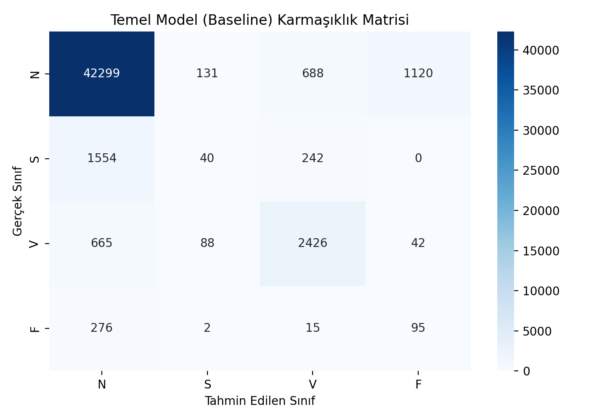

# Bitirme Projesi 1-2: EKG Atım Sınıflandırmasında Sınıf Dengesizliği Çözümü

**Öğrenci:** Rafi Erkoç (Elektrik-Elektronik Mühendisliği)  
**Danışman:** Arş. Gör. Meral Kılıçarslan  
**Veri Tabanı:** PhysioNet MIT-BIH Arrhythmia Database (Açık Erişim)  
**Bütçe:** 0,00 TL (Tamamen Yazılım Tabanlı)  

---

## 🎯 Projenin Amacı
Bu çalışma, EKG sinyallerinde klinik olarak hayati risk taşıyan ancak veride çok az bulunan nadir aritmi türlerinin (S, V, F sınıfları) tespitinde sınıf dengesizliği problemini çözmeyi amaçlamaktadır.

---

## 👥 Hasta-Bazlı (Inter-Patient) Eğitim ve Test Ayrımı
Veri sızıntısını (data leakage) engellemek amacıyla aynı hastanın atımları iki kümede birden yer almayacak şekilde ayrılmıştır:
- **Eğitim Kümesi (DS1 - 18 Kayıt):** 101, 106, 108, 109, 112, 115, 118, 119, 201, 203, 205, 207, 208, 209, 215, 220, 223, 230
- **Test Kümesi (DS2 - 22 Kayıt):** 100, 103, 105, 111, 113, 117, 121, 123, 200, 202, 210, 212, 213, 214, 219, 221, 222, 228, 231, 232, 233, 234

---

## 📊 AAMI Sınıfları ve Temel Model (Baseline - Dengeleme Yok) Sonuçları

| Sınıf | Anlamı | Test Atım Sayısı | Kesinlik (Precision) | Duyarlılık (Recall) | F1-Skoru |
|:---:|:---|:---:|:---:|:---:|:---:|
| **N** | Normal | 44,238 | 0.944 | 0.956 | **0.950** |
| **S** | Supraventriküler (Nadir) | 1,836 | 0.153 | 0.022 | **0.038** |
| **V** | Ventriküler (Nadir) | 3,221 | 0.720 | 0.753 | **0.736** |
| **F** | Füzyon (Çok Nadir) | 388 | 0.076 | 0.245 | **0.116** |

- **Makro-Ortalama F1-Skoru:** **0.460**  
- **R Tepesi Ön İşleme F1 Başarımı:** **0.831**

### Temel Model Karmaşıklık Matrisi (Confusion Matrix)

---

## 🔍 Temel Bulgular ve Sıradaki Adım
Dengeleme yapılmadığında model çoğunluk sınıfında (N) yüksek başarı (0.950 F1) gösterse de, nadir sınıflardan **S sınıfında duyarlılık %2.2'ye (F1: 0.038)** düşmektedir. Model nadir hastalıklı atımların %98'ini kaçırmaktadır.  
**Sıradaki Adım:** Bu dengesizliği gidermek için yalnızca eğitim kümesine (DS1) **SMOTE** ve **Sınıf Ağırlıklandırma (Class Weights)** yöntemleri entegre edilecektir.
